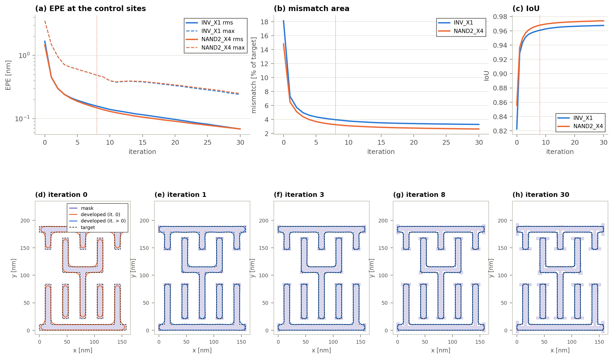
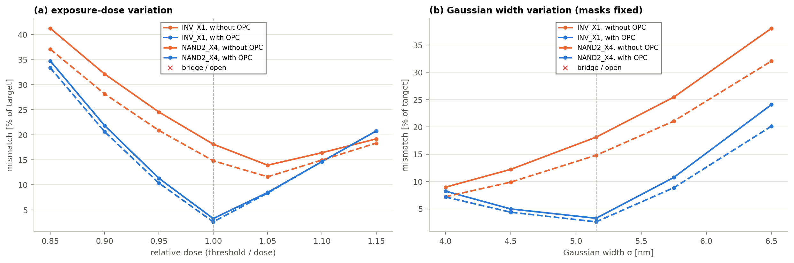
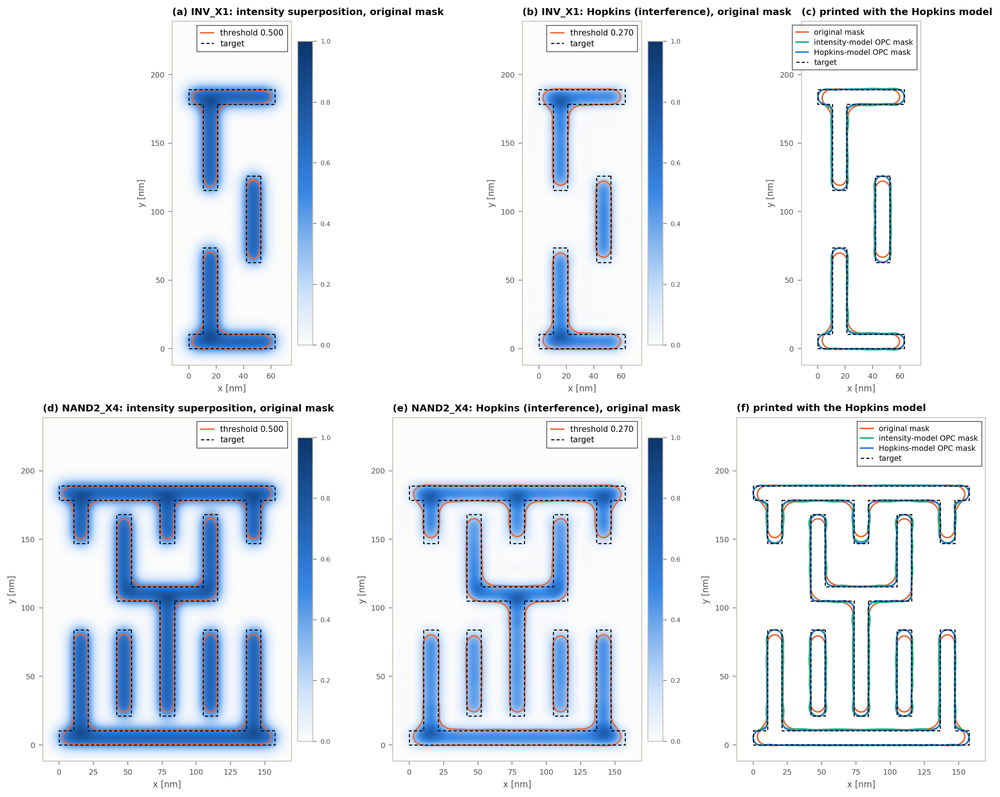
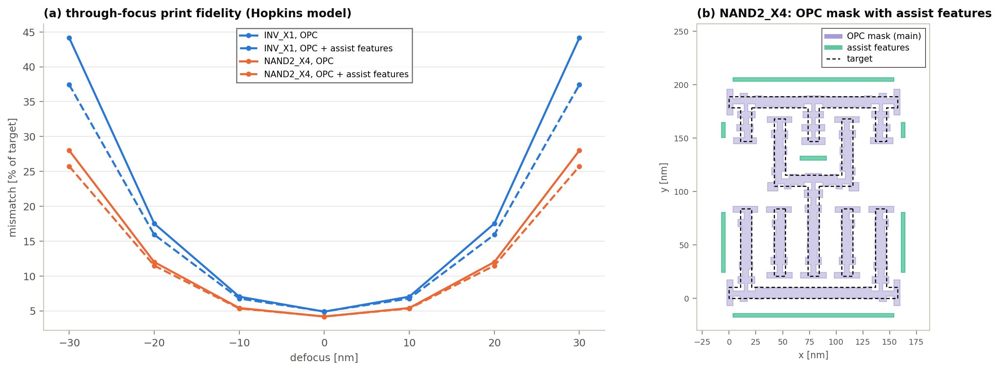

# Appendix — 가우시안 광량 중첩 모델 기반 Metal1 표준 셀 OPC 도구

논문 본문에 넣지 않은 보충 자료이다. 그림과 표의 원본은 `outputs/assignment/`에 있다.
모든 결과는 아래 명령 하나로 다시 만들 수 있다.

```bash
pip install -r requirements.txt
python run.py assignment
```

| 폴더 | 내용 |
|---|---|
| `outputs/assignment/figures/` | 논문 그림 1–6 |
| `outputs/assignment/appendix/` | 이 문서의 그림 A1–A4 |
| `outputs/assignment/tables/` | 표 원본(CSV) |
| `outputs/assignment/gds/` | 목표 패턴과 OPC 결과 GDS (KLayout용 `layers.lyp` 포함) |
| `outputs/assignment/metrics.json` | 모든 수치 |

웹 앱: https://claude.ai/artifact/1FQPHVUnP4x9WMkXjsHak4

---

## A1. OPC 수렴 과정



- 첫 반복에서 오차율이 크게 줄었다. INV_X1은 18.1 %에서 7.3 %로, NAND2_X4는 14.8 %에서 6.5 %로 줄었다.
- 두 셀 모두 8번째 반복에서 수렴 조건(EPE rms < 0.2 nm, 최대 < 0.5 nm)을 만족하였다.
- 이후 30번째 반복까지는 변화가 작다. 최종 오차율은 3.27 %, 2.62 %이다.
- (d)–(h)는 NAND2_X4 마스크의 변화이다. 선 끝의 hammerhead와 바깥 모서리의 serif가 첫 반복부터 생긴다.

| 셀 | 조각 수 | 마스크 꼭짓점 수 | MRC 위반 | 계산 시간 |
|---|---|---|---|---|
| INV_X1 | 108 | 192 | 0 | 1.36 s |
| NAND2_X4 | 316 | 576 | 0 | 2.18 s |

## A2. 노광량과 가우시안 폭 변화



(a)는 논문 그림 6과 같은 결과이다. (b)는 마스크를 고정하고 σ만 바꾼 결과이다.
OPC 마스크는 σ=5.155 nm에 맞춰 만들었다. 따라서 σ가 달라지면 보정 효과가 줄어든다.

오차율 (목표 면적 대비 불일치 면적, %):

| σ [nm] | 4.0 | 4.5 | **5.155** | 5.75 | 6.5 |
|---|---|---|---|---|---|
| INV_X1, OPC 전 | 8.97 | 12.23 | **18.13** | 25.45 | 38.07 |
| INV_X1, OPC 후 | 8.24 | 4.98 | **3.28** | 10.74 | 24.09 |
| NAND2_X4, OPC 전 | 7.22 | 9.90 | **14.82** | 21.06 | 32.08 |
| NAND2_X4, OPC 후 | 7.17 | 4.38 | **2.62** | 8.86 | 20.14 |

- σ가 작아지면 OPC 전 마스크가 더 잘 인쇄된다. σ=4.0 nm에서는 OPC 전후 차이가 거의 없다. OPC 마스크가 과보정되기 때문이다.
- σ가 커지면 두 마스크 모두 나빠진다. 그래도 OPC 마스크가 OPC 전보다 12–15 %p 좋다.
- 모든 조건에서 bridge와 open은 없었다.

## A3. 격자 가중치 표로 계산한 경우

논문 그림 2(b)의 λ 격자 가중치 표(3.5 nm 칸)로만 노광량을 계산하면 결과가 달라진다.
아래는 표 방식으로 인쇄했을 때의 결과이다.

| 마스크 | INV_X1 오차율 (%) | INV_X1 IoU | NAND2_X4 오차율 (%) | NAND2_X4 IoU |
|---|---|---|---|---|
| 원래 마스크 | 5.94 | 0.941 | 4.75 | 0.953 |
| 가우시안 모델로 만든 OPC 마스크 | 12.78 | 0.885 | 11.03 | 0.899 |
| 표 방식으로 만든 OPC 마스크 | 2.71 | 0.973 | 2.11 | 0.979 |

- 표 방식은 3.5 nm 칸 단위로 빛을 더한다. 그래서 칸보다 작은 모서리 효과를 보지 못한다.
- 가우시안 모델용 OPC 마스크는 표 방식에서 과보정이 된다.
- 같은 모델로 만들고 같은 모델로 평가해야 보정이 맞는다. 본문은 0.5 nm 격자의 가우시안 모델을 사용하였다.

## A4. Hopkins 모델 비교



- Hopkins 모델은 부분 결맞음 조명(annular 0.3/0.7)을 사용하였다. λ=13.5 nm, NA=0.55는 같다.
- 문턱값은 넓은 도형의 경계가 제자리에 인쇄되는 값으로 정하였다. 그 값은 0.27이다.
- 두 모델 모두 선 끝 후퇴와 모서리 둥글어짐을 보인다.

Hopkins 모델로 인쇄한 결과:

| 마스크 | INV_X1 오차율 (%) | IoU | CD 오차 (nm) | NAND2_X4 오차율 (%) | IoU | CD 오차 (nm) |
|---|---|---|---|---|---|---|
| 원래 마스크 | 21.18 | 0.806 | 0.84 | 18.41 | 0.832 | 1.14 |
| 가우시안 모델 OPC 마스크 | 15.22 | 0.865 | 1.46 | 14.21 | 0.873 | 1.60 |
| Hopkins 모델 OPC 마스크 | 4.88 | 0.952 | 0.10 | 4.18 | 0.959 | 0.15 |

- 가우시안 모델 OPC 마스크도 오차율은 줄였다. 하지만 CD 오차는 오히려 커졌다.
- 선 끝과 모서리의 보정 방향은 맞지만, 선폭 보정량이 모델마다 다르기 때문으로 보인다.

## A5. 보조 패턴(SRAF)과 초점 변화



- 보조 패턴은 폭 3.5 nm(MRC 최소 폭), 목표 경계에서 14 nm 거리에 규칙 기반으로 넣었다. 길이 10.5 nm 미만인 막대는 뺐다.
- 막대 수는 INV_X1 8개, NAND2_X4 7개이다. 보조 패턴을 넣은 뒤 OPC를 다시 수행하였다.

Hopkins 모델, OPC 마스크의 오차율 (%):

| defocus [nm] | −30 | −20 | −10 | 0 | +10 | +20 | +30 |
|---|---|---|---|---|---|---|---|
| INV_X1, OPC | 44.14 | 17.52 | 7.04 | 4.88 | 7.04 | 17.52 | 44.14 |
| INV_X1, OPC + SRAF | 37.43 | 15.93 | 6.77 | 4.91 | 6.77 | 15.93 | 37.43 |
| NAND2_X4, OPC | 28.00 | 12.00 | 5.41 | 4.18 | 5.41 | 12.00 | 28.00 |
| NAND2_X4, OPC + SRAF | 25.73 | 11.49 | 5.34 | 4.20 | 5.34 | 11.49 | 25.73 |

- 초점이 벗어날수록 보조 패턴의 효과가 커진다. ±30 nm에서 INV_X1은 6.7 %p 좋아졌다.
- 가우시안 모델에서는 효과가 거의 없다. D=1에서 3.275 %가 3.284 %로 바뀌었다.
- 가우시안 모델은 빛을 더하기만 하므로, 간섭을 이용하는 보조 패턴의 효과를 나타내지 못한다.

## A6. CD 게이지 측정값

모든 게이지의 목표 선폭은 10.5 nm이다. 단위는 nm이다.

| 셀 | 위치 | OPC 전 | OPC 후 |
|---|---|---|---|
| INV_X1 | top bar | 9.879 | 10.522 |
| INV_X1 | upper stem | 9.879 | 10.499 |
| INV_X1 | right bar | 9.879 | 10.510 |
| INV_X1 | lower stem | 9.879 | 10.499 |
| INV_X1 | bottom bar | 9.879 | 10.522 |
| NAND2_X4 | top bar | 10.043 | 10.561 |
| NAND2_X4 | stub left | 9.878 | 10.480 |
| NAND2_X4 | stub mid | 9.878 | 10.487 |
| NAND2_X4 | stub right | 9.878 | 10.480 |
| NAND2_X4 | U left | 9.879 | 10.488 |
| NAND2_X4 | U right | 9.879 | 10.488 |
| NAND2_X4 | U bar | 10.195 | 10.624 |
| NAND2_X4 | center stem | 9.879 | 10.501 |
| NAND2_X4 | lower 1 | 9.879 | 10.505 |
| NAND2_X4 | lower 2 | 9.879 | 10.507 |
| NAND2_X4 | lower 3 | 9.879 | 10.507 |
| NAND2_X4 | lower 4 | 9.879 | 10.505 |
| NAND2_X4 | bottom bar | 10.043 | 10.547 |

- 길고 고립된 선은 모두 9.879 nm로 인쇄되었다. A7의 해석해와 같다.
- top/bottom bar와 U bar는 주변 도형의 빛을 받아 조금 더 넓다.

## A7. 해석해 검증

2차원 가우시안은 x, y 방향으로 나눌 수 있다. 따라서 긴 직선의 단면은 1차원 문제가 된다.

**고립된 선의 인쇄 선폭.** 폭 w인 긴 선에서 x 위치의 노광량은 다음과 같다.

$$E(x)=\frac{1}{2}\left[\operatorname{erf}\left(\frac{x+w/2}{\sqrt{2}\,\sigma}\right)-\operatorname{erf}\left(\frac{x-w/2}{\sqrt{2}\,\sigma}\right)\right]$$

w=10.5 nm, σ=5.155 nm를 넣으면 선 중앙의 노광량은 0.692이다.
E(x)=0.5인 위치를 풀면 인쇄 선폭은 9.879 nm이다. 시뮬레이션 값과 같다.

**선 끝 후퇴량.** 선이 y<0 쪽으로 길게 뻗어 있고 y=0에서 끝난다고 하자. 선 중앙을 따라가면 노광량은 다음과 같다.

$$E(0,y)=\operatorname{erf}\left(\frac{w}{2\sqrt{2}\,\sigma}\right)\cdot\frac{1}{2}\operatorname{erfc}\left(\frac{y}{\sqrt{2}\,\sigma}\right)$$

E=0.5인 위치는 y=−3.05 nm이다. 시뮬레이션의 선 끝 후퇴량은 평균 2.99 nm, 최대 3.04 nm이다.

이 밖에 가중치 합, 래스터화 면적, EPE 부호, MRC 등은 `test_opc.py`의 자동 시험으로 확인하였다.

```bash
python -m pytest -q
```

## A8. 생성형 AI 활용 기록

도구는 Claude Code(Anthropic)로 만들었다. 작성자가 요구 사항을 단계별로 제시하였다. AI가 작성한 코드를 직접 실행하고, 결과를 보고 수정을 요청하였다.

주요 요구 사항은 다음과 같다.

1. λ 격자 기반 목표 패턴 생성
2. 정규화된 가우시안 빛 분포와 FFT 합성곱을 이용한 노광 계산
3. 문턱값 현상과 윤곽 추출
4. 조각 분할 EPE 되먹임 OPC와 MRC
5. 같은 기준의 정량 지표
6. 웹 앱 화면과 결과 저장

모델과 조건의 선택, 결과 해석은 작성자가 결정하였다.

| 문제 | 원인 | 해결 및 검증 |
|---|---|---|
| λ 격자 가중치 표의 중심이 한 칸 어긋남 | 짝수 배 부분 격자로 적분하여 중심이 밀림 | 홀수 배로 수정. 표의 상하좌우 대칭과 중심값 확인 |
| NAND2_X4 병합 결과가 5개가 아닌 7개 도형 | 다각형 합집합이 한 번에 끝나지 않음 | 도형 수가 변하지 않을 때까지 반복 병합. 도형 수 3개, 5개 확인 |
| 앱과 Python의 불일치 면적이 다름 | 앱은 격자 개수, Python은 부분 면적으로 계산 | 앱도 부분 면적 방식으로 통일. INV_X1 18.11 % 대 18.12 %로 일치 |
| 빛 분포 범위가 계산 영역보다 큰 조건에서 오류 | 가중치를 놓을 때 주기 경계를 처리하지 않음 | 주기 경계로 감아서 배치. 가중치 합 1 확인 |
| 그림 범례가 패턴을 가리고 한글이 깨짐 | 범례 위치와 글꼴 설정 | 범례 영역을 따로 두고 그림 안 표기를 영문으로 통일 |
